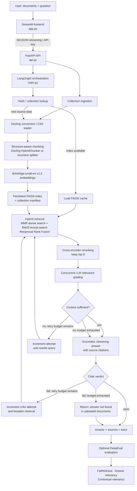

# OmniRAG AI

**OmniRAG AI** is a document-grounded, agentic RAG application. Upload documents to a persistent knowledge collection, ask questions in a Streamlit chat interface, and receive streaming answers that are retrieved, ranked, checked for context sufficiency, cited, and reviewed by a critic before they are returned.

The project consists of a Streamlit frontend, a FastAPI service, and a conditional LangGraph workflow. It is designed to answer from the supplied knowledge base rather than from the model's general knowledge.

## What it does

- Ingests and persists document collections.
- Extracts structured content and provenance from many office, document, image, web, email, and caption formats.
- Combines semantic and lexical search, then reranks and LLM-grades the retrieved chunks.
- Retries with a rewritten query when the available context is insufficient.
- Requires source-grounded answers with `[S1]`, `[S2]`, … citations.
- Critiques each generated answer for unsupported claims, insufficient context, and relevance before accepting it.
- Evaluates completed answers with DeepEval and exposes faithfulness, answer relevancy, and contextual relevancy scores.

## Architecture



### Why the graph is dynamic

The workflow is conditional at multiple points rather than following one fixed path:

1. **Cache branch:** an existing collection index bypasses document conversion, chunking, and embedding. A new upload follows the ingestion path and is persisted to the collection.
2. **Context branch:** after relevance filtering, an LLM decides whether the retrieved context is sufficient. If not, OmniRAG can make up to two expansion/rewrite retries before generation proceeds with the best available context.
3. **Critic branch:** the critic accepts a grounded answer, or sends the graph back to retrieval. It can make up to two critic-driven retries; a repeatedly unsupported answer becomes an explicit “answer not found” response.
4. **Failure branch:** unreadable or unsupported input does not create an empty index; the graph returns an explanatory result instead.

The frontend receives the graph's node-by-node events and generated tokens as NDJSON, so it can display live pipeline progress and answer streaming.

## Retrieval and context pipeline

### 1. Document ingestion

| Input type | Processing |
| --- | --- |
| CSV | LangChain `CSVLoader` preserves rows as documents. |
| PDF, Word, spreadsheets, presentations, images, HTML, Markdown, email, captions, and more | Docling `DocumentConverter` extracts content. `HybridChunker` preserves headings, page provenance, and structure. |

Supported backend extensions include PDF, DOC/DOCX, ODT, EPUB, XLS/XLSX/ODS, PPT/PPTX/ODP, PNG/JPEG/TIFF/BMP/WebP, HTML/XHTML, Markdown/AsciiDoc/LaTeX, EML/MSG, VTT, and CSV.

For non-Docling CSV content, `RecursiveCharacterTextSplitter` uses 800-character chunks with 150-character overlap. Document-originated chunks retain source filename, page numbers, headings, and chunk identifiers.

### 2. Persistent knowledge collections

Collections are stored beneath `OMNIRAG_DATA_DIR` (the repository directory by default; `/data` in Docker):

- `knowledge_base_collections/` holds a manifest and FAISS index for each named collection.
- File contents are SHA-256 hashed during collection ingestion, so duplicate uploads are skipped.
- A small in-memory LRU cache retains recently used FAISS indexes.
- A file-hash cache also prevents rebuilding an index for the same source set.

### 3. Hybrid retrieval

OmniRAG runs two retrieval strategies for each query:

- **Dense retrieval:** FAISS vector search using MMR for semantic relevance and diversity.
- **Sparse retrieval:** BM25 lexical search over all indexed chunks.
- **Fusion:** Reciprocal Rank Fusion (RRF) combines both rankings.
- **Reranking:** `cross-encoder/ms-marco-MiniLM-L-6-v2` scores question/chunk pairs and keeps the best eight chunks by default.
- **Relevance grading:** an LLM filters out chunks that cannot help answer the question. The grade calls run concurrently (default concurrency: 8).

The candidate pool grows as the graph retries, up to 20 dense results. The relevant chunks become the answer context; this keeps unrelated retrieved material out of the final prompt.

## Grounding and hallucination control

OmniRAG uses layered controls; no RAG system can guarantee zero hallucinations, but these checks reduce unsupported output and make it visible:

1. **Context-only generation:** the answer prompt instructs the model to use only supplied context, avoid invented facts, and say when the context is insufficient.
2. **Source-aware context:** every selected chunk is labeled `[S1]`, `[S2]`, etc., with filename and—when available—page and heading metadata. Factual claims are expected to cite those IDs.
3. **Relevance filtering:** LLM grading removes irrelevant chunks before they reach generation.
4. **Sufficiency gate:** a separate grader checks completeness and coverage. Insufficient context triggers query rewriting and another retrieval cycle.
5. **Post-generation critic:** the critic checks the answer against the same selected context and returns `pass` or `fail` with one of: `sufficient_context`, `insufficient_context`, `hallucination`, or `irrelevant_answer`.
6. **Safe fallback:** if critique retries are exhausted, the system returns “Answer not found in the uploaded documents” instead of presenting a repeatedly failed answer as trustworthy.
7. **Inspectable sources:** the UI exposes the retrieved chunks, citations, source names, pages, headings, and pipeline trace.

## Models and technology

| Area | Technology / model | Role |
| --- | --- | --- |
| Answering, grading, rewriting, critic | OpenAI `gpt-4o-mini` via LangChain | Deterministic (`temperature=0`) structured decisions and streamed answer generation. |
| Embeddings | `BAAI/bge-small-en-v1.5` via Hugging Face | Creates vector representations for FAISS. |
| Reranking | `cross-encoder/ms-marco-MiniLM-L-6-v2` | Jointly ranks question/chunk pairs after hybrid retrieval. |
| Vector store | FAISS | Local persistent semantic index. |
| Sparse retrieval | BM25 (`rank-bm25`) | Keyword-aware lexical recall. |
| Orchestration | LangGraph | Conditional, retry-capable RAG graph. |
| Document intelligence | Docling | Multi-format conversion and structure-aware chunking. |
| API | FastAPI + Uvicorn | Protected, rate-limited HTTP/NDJSON endpoints. |
| UI | Streamlit | Collection management, uploads, chat, sources, pipeline trace, and evaluation. |
| Evaluation | DeepEval | Faithfulness, answer relevancy, and contextual relevancy measurements. |
| Packaging | Docker Compose | One-command local deployment. |

## Evaluation

Evaluation is run on demand after an answer completes, either from the UI or through the `/evaluate` endpoints. The same filtered retrieval context used for generation is evaluated with three DeepEval metrics:

| Metric | What it checks |
| --- | --- |
| Faithfulness | Whether the answer is supported by the retrieved context. |
| Answer relevancy | Whether the answer addresses the user's question. |
| Contextual relevancy | Whether the retrieved context is relevant to the question. |

Each metric uses the application's `gpt-4o-mini` judge and a passing threshold of **0.70**. Metrics execute in parallel. The reported overall score is the mean of metrics that returned a score; it passes when that mean is at least 0.70.

## Repository layout

```text
omnirag-ai/
├── app.py                     # Streamlit frontend
├── api.py                     # FastAPI API, streaming, collections, security controls
├── main.py                    # LangGraph RAG workflow, retrieval, critique, evaluation
├── requirements.txt           # Frontend dependencies
├── requirements-backend.txt   # API / RAG dependencies
├── Dockerfile                 # Backend container
├── Dockerfile.frontend        # Frontend container
├── docker-compose.yml         # Two-service local deployment
└── omnirag_logo.png           # UI branding asset
```

## Run locally from GitHub

### Prerequisites

- [Git](https://git-scm.com/)
- Python **3.12**
- An [OpenAI API key](https://platform.openai.com/api-keys) with access to `gpt-4o-mini`
- For Docker setup: Docker Desktop with Docker Compose

### 1. Clone the repository

```bash
git clone https://github.com/<your-github-username>/omnirag-ai.git
cd omnirag-ai
```

Replace `<your-github-username>` with the account or organization that owns the repository.

### 2. Create `.env`

Create a file named `.env` in the repository root. Never commit it.

```dotenv
OPENAI_API_KEY=your_openai_api_key_here
OMNIRAG_API_KEY=choose_a_long_random_local_secret

# Optional configuration
OMNIRAG_API_URL=http://127.0.0.1:8000
OMNIRAG_CORS_ORIGINS=http://localhost:8501,http://127.0.0.1:8501
OMNIRAG_DATA_DIR=.
```

`OMNIRAG_API_KEY` protects the data-bearing API endpoints. The Streamlit application sends it as the `X-API-Key` header.

### Option A — Docker Compose (recommended)

Docker handles the Python dependencies and stores indexes in the named `omnirag_data` volume.

```bash
docker compose up --build
```

Open:

- Frontend: <http://localhost:8501>
- Interactive API documentation: <http://localhost:8000/docs>
- Health check: <http://localhost:8000/health>

Stop the application with `Ctrl+C`; to run it in the background, use:

```bash
docker compose up --build -d
```

### Option B — Run with Python

Create and activate a virtual environment:

```bash
python3.12 -m venv .venv
source .venv/bin/activate       # macOS / Linux
# .venv\Scripts\Activate.ps1   # Windows PowerShell
python -m pip install --upgrade pip
```

Install both dependency groups:

```bash
pip install -r requirements-backend.txt
pip install -r requirements.txt
```

Start the API in the first terminal:

```bash
uvicorn api:app --host 0.0.0.0 --port 8000
```

Start the frontend in a second terminal (activate the same virtual environment first):

```bash
streamlit run app.py
```

Then visit <http://localhost:8501>. The first start can take longer because Docling and Hugging Face models may need to download.

## Use the application

1. Open the Streamlit interface.
2. Select an existing collection or create a new one.
3. Upload one or more supported documents. Subsequent uploads append to the collection; duplicate content is ignored.
4. Ask a question about the documents.
5. Watch live pipeline steps and streamed output.
6. Open **Sources** to inspect cited context and provenance.
7. Select **Evaluate answer** to run the three DeepEval checks.

## API overview

All data-bearing routes require `X-API-Key: <OMNIRAG_API_KEY>`.

| Route | Purpose |
| --- | --- |
| `GET /health` | Service health and configured retrieval provider summary. |
| `GET /supported-formats` | Supported backend file extensions. |
| `GET /collections` | List persisted collections. |
| `POST /collections` | Create a collection. |
| `POST /query` | Ingest optional uploads and return a complete RAG answer. |
| `POST /query/stream` | Same RAG flow as NDJSON events and generated tokens. |
| `POST /evaluate` | Evaluate an answer against its retrieval context. |
| `POST /evaluate/stream` | Stream evaluation metrics as they finish. |

The API includes CORS controls, a simple per-client in-process rate limiter, upload limits (25 MB per file, 100 MB total, 20 files by default), filename sanitization, and temporary-upload cleanup.

## Configuration

| Variable | Default | Purpose |
| --- | --- | --- |
| `OPENAI_API_KEY` | — | Required OpenAI credential. |
| `OMNIRAG_API_KEY` | — | Required shared secret for protected API routes. |
| `OMNIRAG_API_URL` | `http://127.0.0.1:8000` | Frontend URL for the API. Docker overrides it to `http://api:8000`. |
| `OMNIRAG_DATA_DIR` | repository directory | Location for persistent indexes and collection manifests. |
| `OMNIRAG_RERANKER_MODEL` | `cross-encoder/ms-marco-MiniLM-L-6-v2` | Hugging Face cross-encoder used for reranking. |
| `OMNIRAG_VECTOR_CANDIDATES` | `30` | Dense candidate retrieval pool. |
| `OMNIRAG_LEXICAL_CANDIDATES` | `30` | BM25 candidate retrieval pool. |
| `OMNIRAG_RRF_K` | `60` | RRF fusion constant. |
| `OMNIRAG_RERANK_TOP_N` | `8` | Chunks retained after reranking. |
| `OMNIRAG_MEMORY_INDEXES` | `8` | Maximum number of in-memory FAISS indexes. |
| `OMNIRAG_MAX_UPLOAD_FILE_BYTES` | `25 MB` | Maximum size for one file. |
| `OMNIRAG_MAX_UPLOAD_TOTAL_BYTES` | `100 MB` | Maximum aggregate upload size per request. |
| `OMNIRAG_MAX_FILES_PER_REQUEST` | `20` | Maximum file count per request. |
| `OMNIRAG_RATE_LIMIT_WINDOW_SECONDS` | `60` | Rate-limit window duration. |
| `OMNIRAG_RATE_LIMIT_MAX_REQUESTS` | `20` | Maximum protected requests per client in the window. |
| `OMNIRAG_CORS_ORIGINS` | local Streamlit URLs | Comma-separated CORS allowlist. |

## Notes for contributors

- Keep credentials in `.env`; it is already ignored by Git.
- Do not commit `vectorstore_cache/`, `knowledge_base_collections/`, or `.deepeval/`; they are local generated data.
- When changing graph behavior, update the Mermaid diagram and the retry/safety descriptions above so the documentation remains accurate.
