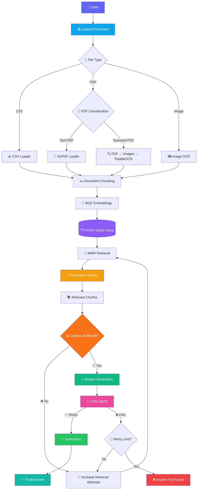

# 🚀 OmniRAG — Agentic RAG Explorer

<div align="center">

### 🧠 Intelligent Multi-Format Document Question Answering with Agentic RAG

**Upload → Retrieve → Grade → Generate → Critique → Evaluate**

[](https://www.python.org/)
[](https://www.langchain.com/)
[](https://www.langchain.com/langgraph)
[](https://github.com/facebookresearch/faiss)
[](https://streamlit.io/)
[](https://openai.com/)

</div>

---

## 🌟 Overview

**OmniRAG** is an **agentic Retrieval-Augmented Generation (RAG) system** designed to answer questions from multiple types of user-uploaded documents.

Unlike a basic RAG pipeline that simply retrieves documents and generates an answer, OmniRAG introduces multiple validation and self-correction stages to improve retrieval quality and reduce unsupported answers.

### ✨ What makes OmniRAG different?

* 📄 Multi-format document ingestion
* 🔍 Automatic file-type detection
* 🖼️ OCR support for images and scanned PDFs
* ✂️ Intelligent document chunking
* 🧬 Hugging Face embeddings
* ⚡ FAISS vector search
* 🎯 MMR-based retrieval
* 🧑‍⚖️ LLM relevance grading
* 📊 Context sufficiency checking
* 🤖 Context-grounded answer generation
* 🧐 Critic-based hallucination detection
* 🔄 Automatic retry mechanism
* 🚫 Answer-not-found protection
* 📈 Four answer-quality evaluation metrics
* 🎨 Interactive Streamlit interface

OmniRAG currently supports **PDF, CSV and image inputs** through its Streamlit interface.

---

# 🏗️ Architecture



---

# 🔄 OmniRAG Pipeline

```text
                    ┌──────────────────┐
                    │   👤 User        │
                    └────────┬─────────┘
                             │
                             ▼
                    ┌──────────────────┐
                    │ 📤 Upload File   │
                    └────────┬─────────┘
                             │
                             ▼
                    ┌──────────────────┐
                    │ 📁 File Detection│
                    └────────┬─────────┘
                             │
              ┌──────────────┼──────────────┐
              ▼              ▼              ▼
           📊 CSV       📄 PDF          🖼️ Image
              │              │              │
              │       ┌──────┴──────┐       │
              │       ▼             ▼       │
              │    Text PDF     Scanned PDF │
              │       │             │       │
              │       │          🔍 OCR      │
              │       │             │       │
              └───────┴──────┬──────┴───────┘
                              ▼
                       ✂️ Chunking
                              │
                              ▼
                     🧬 Embeddings
                              │
                              ▼
                      🗂️ FAISS Store
                              │
                              ▼
                       🔎 MMR Retrieval
                              │
                              ▼
                     🎯 Relevance Grader
                              │
                              ▼
                  📚 Filter Relevant Chunks
                              │
                              ▼
                  📊 Context Sufficiency
                         │          │
                    ❌ No│          │Yes
                         ▼          ▼
                   🔄 Retry    🤖 Generate
                         │          │
                         └─────┐    ▼
                               │ 🧐 Critic
                               │    │
                               │ ┌──┴──┐
                               │ ▼     ▼
                               │PASS  FAIL
                               │ │     │
                               │ ▼     ▼
                               │ Eval  Retry
                               │ │
                               ▼ ▼
                         📈 Evaluation
                              │
                              ▼
                         ✅ Answer
```

---

# 🧩 Core Components

## 📂 1. Multi-Format Ingestion

OmniRAG accepts:

```text
📄 PDF
📊 CSV
🖼️ PNG
🖼️ JPG
🖼️ JPEG
🖼️ BMP
```

The frontend explicitly configures these supported file types.

The backend automatically routes files based on their extension.

---

# 📄 2. Intelligent PDF Processing

OmniRAG distinguishes between:

### 📄 Text PDF

Uses:

```python
PyPDFLoader
```

### 🖼️ Scanned PDF

Uses:

```text
PDF
 ↓
PDF → Images
 ↓
PaddleOCR
 ↓
Extracted Text
```

The system checks the extracted text from the first few pages to determine whether the PDF is text-based or scanned.

---

# 🔍 3. OCR

For scanned documents and images, OmniRAG uses **PaddleOCR**.


The OCR pipeline processes extracted text into LangChain `Document` objects for downstream RAG processing.

---

# ✂️ 4. Intelligent Chunking

OmniRAG uses:

```python
RecursiveCharacterTextSplitter
```

### Configuration

| Parameter     | Value |
| ------------- | ----: |
| Chunk Size    | `800` |
| Chunk Overlap | `150` |

The splitter uses paragraph, line, sentence and whitespace separators.

---

# 🧬 5. Embedding Model

OmniRAG uses the Hugging Face embedding model:

```text
BAAI/bge-small-en-v1.5
```

The embeddings are generated from document chunks before storing them in the vector database.

---

# ⚡ 6. FAISS Vector Database

The project uses **FAISS** for vector storage and similarity retrieval.

```text
Documents
    ↓
Chunks
    ↓
Embeddings
    ↓
FAISS
    ↓
Relevant Documents
```

---

# 🎯 7. MMR Retrieval

OmniRAG uses **Maximum Marginal Relevance (MMR)** retrieval.

This allows the system to retrieve relevant information while reducing redundant chunks.

The retrieval depth dynamically increases based on previous retrieval and critic attempts, up to a maximum of 20 documents.

---

# 🧑‍⚖️ 8. Relevance Grading

Retrieved documents are passed through an LLM-based relevance grader.

```text
Retrieved Document
        │
        ▼
   🎯 Grader Agent
        │
    ┌───┴───┐
    ▼       ▼
   YES      NO
    │       │
    ▼       ▼
  Keep    Remove
```

The grader returns `yes` or `no`, and only relevant chunks continue through the pipeline.

---

# 📊 9. Context Sufficiency Agent

Before generating an answer, OmniRAG checks whether the retrieved context contains enough information.

It evaluates:

* Completeness
* Coverage
* Missing information

If the context is insufficient, retrieval is retried with an increased retrieval depth.

---

# 🤖 10. Grounded Answer Generation

The answer-generation agent is explicitly instructed to:

```text
✓ Use only retrieved context
✓ Avoid unsupported facts
✓ Avoid hallucination
✓ Clearly state when information is insufficient
✓ Produce concise answers
```

---

# 🧐 11. Critic Agent

OmniRAG uses a separate critic stage to validate the generated answer.

The critic checks:

```text
Question
   +
Context
   +
Generated Answer
        │
        ▼
   🧐 Critic Agent
        │
   ┌────┴────┐
   ▼         ▼
 PASS       FAIL
   │         │
   ▼         ▼
Evaluation  Retry
```

The critic can identify:

* `sufficient_context`
* `insufficient_context`
* `hallucination`
* `irrelevant_answer`

---

# 🔄 12. Self-Correction

If the critic rejects an answer, OmniRAG can retry the pipeline.

The system maintains separate counters for:

```text
retrieval_attempts
critic_attempts
```

If the critic continues to fail after the configured retry limit, the system returns:

```text
❌ Answer not found in the uploaded documents.
```

---

# 📈 13. Evaluation

OmniRAG evaluates the final response using four metrics:

| Metric                   | What it measures                               |
| ------------------------ | ---------------------------------------------- |
| 🟢 **Faithfulness**      | Whether the answer is supported by context     |
| 🔵 **Answer Relevancy**  | Whether the answer addresses the question      |
| 🟣 **Context Precision** | Whether retrieved context is focused           |
| 🟠 **Context Recall**    | Whether required information exists in context |

Each score ranges from `0.0` to `1.0`.

---

# 🎨 User Interface

The Streamlit frontend provides:

### 📤 Input

* Document uploader
* Question input
* Ask button

### 📊 Pipeline Statistics

* Retrieval attempts
* Critic attempts
* Critic verdict
* Critic reason

### 💡 Output

* Generated answer
* Verification status
* Evaluation metrics
* Score visualization

## The interface uses a custom dark theme with separate cards for answers, scores and pipeline statistics.

# 🛠️ Tech Stack

### 🧠 LLM & AI

* OpenAI GPT-4o-mini
* LangChain
* LangGraph
* Pydantic

### 🔎 Retrieval

* FAISS
* Hugging Face Embeddings
* BAAI/BGE
* MMR Retrieval

### 📄 Document Processing

* PyPDF
* PDFPlumber
* CSVLoader
* PaddleOCR
* PDF2Image
* PIL

### 🎨 Frontend

* Streamlit
* HTML
* CSS

### 🐍 Development

* Python
* Git
* GitHub

---

# 📁 Project Structure

```text
OmniRAG/
│
├── frontend.py          # 🎨 Streamlit interface
├── main.py              # 🧠 LangGraph RAG pipeline
├── requirements.txt     # 📦 Dependencies
├── .env                 # 🔐 API keys
├── README.md            # 📖 Documentation
│
└── assets/              # 🖼️ Optional assets
```

The frontend imports the compiled LangGraph workflow from `main.py`.

---

# ⚙️ Installation

## 1. Clone the repository

```bash
git clone https://github.com/YOUR_USERNAME/OmniRAG.git

cd OmniRAG
```

## 2. Create a virtual environment

### Windows

```bash
python -m venv venv
venv\Scripts\activate
```

### macOS / Linux

```bash
python3 -m venv venv
source venv/bin/activate
```

## 3. Install dependencies

```bash
pip install -r requirements.txt
```

---

# 🔐 Environment Variables

Create a `.env` file:

```env
OPENAI_API_KEY=your_openai_api_key
```

The application loads environment variables using `python-dotenv` and initializes GPT-4o-mini with temperature `0`.

---

# ▶️ Run OmniRAG

```bash
streamlit run frontend.py
```

Then open the Streamlit URL shown in your terminal.

---

# 🧪 Example

### Upload

```text
📄 research_paper.pdf
```

### Ask

```text
"What are the main conclusions of this research paper?"
```

### OmniRAG

```text
📄 Load
   ↓
✂️ Chunk
   ↓
🧬 Embed
   ↓
🗂️ FAISS
   ↓
🔎 Retrieve
   ↓
🎯 Grade
   ↓
📊 Check Sufficiency
   ↓
🤖 Generate
   ↓
🧐 Critic
   ↓
📈 Evaluate
   ↓
✅ Answer
```

---

# 🧠 Traditional RAG vs OmniRAG

| Traditional RAG | 🚀 OmniRAG           |
| --------------- | -------------------- |
| Retrieve        | Retrieve             |
| Generate        | Grade                |
| Answer          | Check context        |
| —               | Generate             |
| —               | Critic               |
| —               | Retry                |
| —               | Evaluate             |
| —               | Verified / Not Found |

### OmniRAG focuses on:

**Retrieval Quality → Context Quality → Answer Quality → Answer Verification**

---

# 🔮 Future Improvements

* [ ] Persistent FAISS indexes
* [ ] Multi-document knowledge bases
* [ ] Conversation memory
* [ ] Source citations
* [ ] Streaming responses
* [ ] LangSmith observability
* [ ] Docker deployment
* [ ] Cloud deployment
* [ ] Authentication
* [ ] User-specific document collections
* [ ] Improved OCR preprocessing
* [ ] Configurable retrieval parameters
* [ ] Native RAGAS metric integration

---

# 👨‍💻 Author

## Hrishav Raj

**B.Tech | AI / ML & Generative AI Enthusiast**

### Interests

`AI` · `Machine Learning` · `Generative AI` · `LLMs` · `RAG` · `Agentic AI` · `LangChain` · `LangGraph`

---

<div align="center">

## ⭐ OmniRAG

### **Retrieve intelligently. Critique rigorously. Answer reliably.**

Built with ❤️ using **Python · LangChain · LangGraph · FAISS · OpenAI · Streamlit**

</div>
