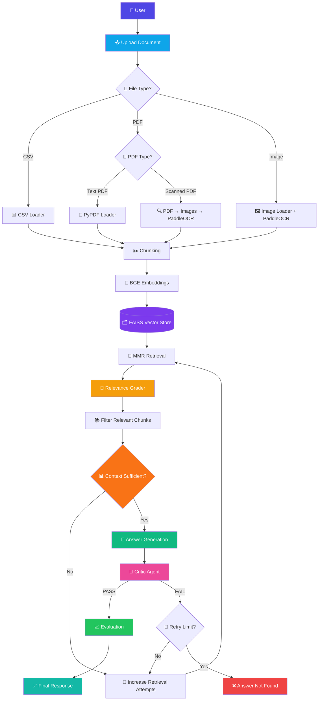

# 🔍 DocMind — Agentic RAG Explorer

<div align="center">

### 🧠 Intelligent Document Question Answering with Agentic RAG

**Upload → Retrieve → Grade → Generate → Critique → Evaluate**

[](https://www.python.org/)
[](https://www.langchain.com/)
[](https://www.langchain.com/langgraph)
[](https://github.com/facebookresearch/faiss)
[](https://streamlit.io/)
[](https://openai.com/)

</div>

---

## 🌟 Overview

**DocMind** is an **agentic Retrieval-Augmented Generation (RAG) system** designed to answer questions from user-uploaded documents while reducing irrelevant retrieval and unsupported answers.

Instead of simply retrieving documents and asking an LLM to generate an answer, DocMind introduces multiple validation stages:

* 📂 Automatic file-type detection
* 📄 PDF, CSV and image ingestion
* 🔎 Scanned-PDF detection
* 🖼️ OCR using PaddleOCR
* ✂️ Recursive document chunking
* 🧬 Hugging Face embeddings
* 🗂️ FAISS vector search
* 🎯 Retrieval relevance grading
* 📊 Context sufficiency checking
* 🤖 LLM answer generation
* 🧐 Critic-based hallucination detection
* 🔄 Automatic retry mechanism
* 📈 Four answer-quality evaluation metrics

The Streamlit frontend provides a clean interface for uploading documents, asking questions and viewing retrieval/critic statistics and evaluation scores.

---

# 🚀 Key Features

| Feature                          | Description                                                        |
| -------------------------------- | ------------------------------------------------------------------ |
| 📄 **Multi-format ingestion**    | Supports PDF, CSV and image files                                  |
| 🧾 **Scanned PDF support**       | Detects scanned PDFs and extracts text with OCR                    |
| 👁️ **Image OCR**                | Extracts text from PNG/JPG/JPEG/BMP images                         |
| ✂️ **Smart Chunking**            | Recursive character splitting with overlap                         |
| 🧬 **Embeddings**                | `BAAI/bge-small-en-v1.5`                                           |
| ⚡ **FAISS Retrieval**            | Fast vector similarity search                                      |
| 🎯 **MMR Retrieval**             | Uses Maximum Marginal Relevance retrieval                          |
| 🧑‍⚖️ **Relevance Grader**       | Filters irrelevant retrieved chunks                                |
| 📊 **Context Sufficiency Agent** | Checks whether retrieved context is enough                         |
| 🤖 **Answer Generator**          | Generates answers strictly from retrieved context                  |
| 🧐 **Critic Agent**              | Checks for hallucination and answer relevance                      |
| 🔄 **Retry Mechanism**           | Re-runs retrieval/critique when necessary                          |
| 🚫 **Answer Not Found**          | Avoids returning unsupported answers after failed validation       |
| 📈 **Evaluation**                | Faithfulness, Answer Relevancy, Context Precision & Context Recall |
| 🎨 **Streamlit UI**              | Interactive document Q&A interface                                 |

---

# 🏗️ System Architecture



---

# 🧠 RAG Pipeline

## 1️⃣ File Detection

DocMind first determines whether the uploaded file is:

```text
CSV
PDF
Image
```

The workflow then routes the file to the appropriate loader.

---

## 2️⃣ PDF Classification

PDF files are checked to determine whether they contain extractable text.

```text
                 PDF
                  │
                  ▼
        ┌───────────────────┐
        │ PDF Classification│
        └─────────┬─────────┘
                  │
          ┌───────┴───────┐
          ▼               ▼
     Text PDF        Scanned PDF
          │               │
     PyPDFLoader      PaddleOCR
          │               │
          └───────┬───────┘
                  ▼
               Chunks
```

The system examines the first pages and classifies the PDF as either **text** or **scanned**.

---

# 🔍 OCR Pipeline

Scanned PDFs are converted into images and processed using **PaddleOCR**.


The same OCR approach is also used for uploaded images.

---

# ✂️ Document Chunking

Documents are split using `RecursiveCharacterTextSplitter`.

### Configuration

```text
Chunk Size      : 800
Chunk Overlap   : 150
```

The splitter uses paragraph, line, sentence and whitespace boundaries to create chunks.

---

# 🧬 Embedding & Vector Search

DocMind uses:

```text
Embedding Model
BAAI/bge-small-en-v1.5
```

Chunks are converted into embeddings and stored in:

```text
FAISS Vector Store
```

---

# 🎯 Intelligent Retrieval

The retriever uses **MMR (Maximum Marginal Relevance)** rather than basic similarity search.

The number of retrieved chunks can increase when the pipeline needs additional retrieval attempts, up to a maximum of 20 chunks.

```text
Question
   │
   ▼
FAISS
   │
   ▼
MMR Retrieval
   │
   ▼
Retrieved Chunks
   │
   ▼
Relevance Grader
   │
   ├── ❌ Irrelevant → Remove
   │
   └── ✅ Relevant → Keep
```

---

# 🧑‍⚖️ Relevance Grading

Each retrieved document is evaluated by an LLM-based relevance grader.

The grader returns:

```text
yes → Relevant
no  → Irrelevant
```

Only relevant chunks continue through the pipeline.

---

# 📊 Context Sufficiency Check

After filtering retrieved chunks, another evaluation stage checks whether the available context is sufficient.

It considers:

* **Completeness**
* **Coverage**
* **Missing information**

If the context is insufficient, the system increases retrieval attempts and searches again.

---

# 🤖 Answer Generation

The answer-generation agent is instructed to use **only the retrieved context**.

Its core rules are:

```text
✓ Use only information from the context
✓ Do not make up facts
✓ Admit when information is insufficient
✓ Be concise and accurate
```

---

# 🧐 Critic Agent

Before accepting an answer, DocMind sends it to a **critic agent**.

The critic evaluates:

```text
Question
   +
Retrieved Context
   +
Generated Answer
        │
        ▼
   🧐 Critic Agent
        │
   ┌────┴────┐
   ▼         ▼
 PASS       FAIL
   │         │
   ▼         ▼
Evaluation  Retry
```

Possible failure reasons include:

* `hallucination`
* `irrelevant_answer`
* `insufficient_context`

---

# 🔄 Self-Correction / Retry

If the critic rejects an answer, the pipeline can retry.

The system tracks:

```text
retrieval_attempts
critic_attempts
```

After the critic reaches the retry limit, the system returns:

> **Answer not found in the uploaded documents.**

This prevents the system from endlessly generating unsupported answers.

---

# 📈 Answer Evaluation

The project evaluates the final answer using four metrics:

| Metric                   | Purpose                                                    |
| ------------------------ | ---------------------------------------------------------- |
| 🟢 **Faithfulness**      | Measures whether the answer is supported by the context    |
| 🔵 **Answer Relevancy**  | Measures whether the answer addresses the question         |
| 🟣 **Context Precision** | Measures whether retrieved context is focused              |
| 🟠 **Context Recall**    | Measures whether the context contains required information |

Each metric is represented as a score between **0.0 and 1.0**.

---

# 🎨 Streamlit Interface

DocMind includes a custom dark-themed Streamlit interface.

### UI includes:

* 📤 Document uploader
* 💬 Question input
* ⚡ Ask button
* 📊 Retrieval statistics
* 🧐 Critic verdict
* 📝 Critic reason
* 💡 Generated answer
* 📈 Evaluation score cards
* ✅ Verified / ❌ Unverified / ⚠️ Not Found status

The frontend supports:

```text
PDF
CSV
PNG
JPG
JPEG
BMP
```

---

# 🛠️ Tech Stack

### 🧠 AI / LLM

* OpenAI GPT-4o-mini
* LangChain
* LangGraph
* Structured LLM outputs

### 🔎 Retrieval

* FAISS
* Hugging Face Embeddings
* `BAAI/bge-small-en-v1.5`
* MMR Retrieval

### 📄 Document Processing

* PyPDF
* PDFPlumber
* CSVLoader
* PaddleOCR
* PDF2Image
* PIL

### 🎨 Frontend

* Streamlit
* Custom HTML/CSS
* Responsive dashboard layout

### 🐍 Programming

* Python
* TypedDict
* Pydantic

The core graph is constructed using LangGraph `StateGraph` and compiled into the final executable graph.

---

# 📁 Project Structure

```text
DocMind/
│
├── frontend.py          # 🎨 Streamlit user interface
├── main.py              # 🧠 LangGraph RAG pipeline
├── requirements.txt     # 📦 Python dependencies
├── .env                 # 🔐 API credentials
├── README.md            # 📖 Documentation
└── assets/              # 🖼️ Optional project assets
```

> Rename `main(3).py` to `main.py` if you want to use the current frontend import exactly as written.

The frontend imports the compiled graph using:

```python
from main import graph
```

---

# ⚙️ Installation

## 1. Clone the repository

```bash
git clone https://github.com/YOUR_USERNAME/DocMind.git

cd DocMind
```

## 2. Create a virtual environment

### Windows

```bash
python -m venv venv

venv\Scripts\activate
```

### macOS / Linux

```bash
python3 -m venv venv

source venv/bin/activate
```

---

## 3. Install dependencies

```bash
pip install -r requirements.txt
```

---

# 🔐 Environment Variables

Create a `.env` file:

```env
OPENAI_API_KEY=your_openai_api_key
```

The project loads environment variables using `python-dotenv` and initializes `GPT-4o-mini` with temperature `0`.

---

# ▶️ Run the Application

Start the Streamlit frontend:

```bash
streamlit run frontend.py
```

Then open the local Streamlit URL displayed in your terminal.

---

# 💡 Example Workflow

```text
1. Upload a PDF / CSV / Image
             ↓
2. Ask a question
             ↓
3. DocMind detects file type
             ↓
4. Extracts document text
             ↓
5. Creates chunks
             ↓
6. Generates embeddings
             ↓
7. Stores vectors in FAISS
             ↓
8. Retrieves relevant chunks
             ↓
9. Grades retrieved chunks
             ↓
10. Checks context sufficiency
             ↓
11. Generates answer
             ↓
12. Critic checks answer
             ↓
13. Retry if necessary
             ↓
14. Evaluate answer
             ↓
15. Return verified response
```

---

# 🧠 Why Agentic RAG?

Traditional RAG:

```text
Question
   ↓
Retrieve
   ↓
Generate
   ↓
Answer
```

DocMind:

```text
Question
   ↓
Retrieve
   ↓
Grade
   ↓
Check Sufficiency
   ↓
Generate
   ↓
Critic
   ↓
Retry if Needed
   ↓
Evaluate
   ↓
Answer
```

The additional validation stages are designed to improve retrieval quality and reduce unsupported answers.

---

# 🚧 Current Limitations

* FAISS vector stores are created during the current pipeline execution rather than being persisted as a reusable index.
* Scanned-PDF OCR currently depends on a local Poppler installation.
* The scanned-PDF loader contains a machine-specific Poppler path that should be configured before running on another system.
* The evaluation stage generates four metric scores through an LLM evaluation chain rather than calling the RAGAS Python metrics directly.
* API access is required for the configured OpenAI model.

---

# 🔮 Future Improvements

### 🔥 Planned / Possible Enhancements

* [ ] Persistent FAISS index
* [ ] Incremental document ingestion
* [ ] Multi-document knowledge base
* [ ] Conversation memory
* [ ] Streaming responses
* [ ] Source/citation display
* [ ] Better OCR preprocessing
* [ ] Configurable retrieval parameters
* [ ] Configurable retry limits
* [ ] Real RAGAS metric integration
* [ ] LangSmith observability
* [ ] Docker deployment
* [ ] Cloud deployment
* [ ] Authentication
* [ ] User-specific document collections

---

# 📊 LangGraph Workflow

The complete graph contains dedicated nodes for:

```text
filetype_node
        ↓
route_file_type
        ↓
CSV / PDF / Image
        ↓
PDF Classification
        ↓
Document Loader
        ↓
chunking_node
        ↓
vectorstore_node
        ↓
retrieval_node
        ↓
filter_chunks_node
        ↓
check_context_sufficiency_node
        ↓
generation_node
        ↓
critic_node
        ↓
ragas_evaluation_node
        ↓
END
```

Retry branches are also connected between retrieval, sufficiency checking and critic validation.

---

# 👨‍💻 Author

**Hrishav Raj**

B.Tech — Artificial Intelligence / Machine Learning Enthusiast

### Interests

`AI` · `Machine Learning` · `Generative AI` · `LLMs` · `RAG` · `LangChain` · `LangGraph` · `Agentic AI`

---

# ⭐ Support

If you find this project useful, consider giving it a ⭐ on GitHub!

---

<div align="center">

### 🔍 DocMind

**Retrieve intelligently. Validate rigorously. Answer reliably.**

Made with ❤️ using Python, LangChain, LangGraph, FAISS, OpenAI & Streamlit.

</div>
